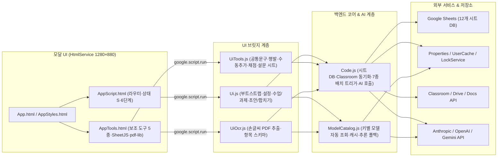

# 자동 생기부 도우미 (`auto_saenggibu`) 코드 분석 보고서

Google Sheets 컨테이너 바인딩 기반의 Google Apps Script(V8) 애플리케이션으로, Google Classroom 과제·제출물 수집부터 AI 초안 작성·병합, 채점, 공통문구, 행발 추천, 수동추가, 손글씨 PDF 추출까지 교사의 학교생활기록부 작성 전 과정을 지원하는 프로젝트입니다.

---

## 1. 전체 아키텍처 및 파일 구성

| 구분 | 파일 | 규모 | 핵심 역할 |
| --- | --- | --- | --- |
| 설정 | [appsscript.json](./appsscript.json#L1-L13), [.clasp.json](./.clasp.json#L1-L16) | 29줄 | V8 런타임, Classroom 고급 서비스, 최소 권한 스코프(`spreadsheets.currentonly`, `drive.readonly` 등) |
| 코어 | [Code.js](./Code.js#L1-L10072) | 10,072줄 | 시트 스키마/서식, Classroom 동기화, 통합 AI 호출·프리페치, 나이스 바이트 검증, 6분 제한 회피 배치 트리거 |
| AI 모델 | [ModelCatalog.js](./ModelCatalog.js#L1-L196) | 196줄 | 사용자 API 키별 모델 목록 조회·정식 모델 선별·6시간 캐시·추론 수준 검증 및 폴백 |
| 서버 UI | [Ui.js](./Ui.js#L1-L1234) | 1,234줄 | 모달 실행, 부트스트랩, 설정, 수업/과제 관리, 제출물/초안/합치기 조회·수정·내보내기 |
| 도구 UI | [UiTools.js](./UiTools.js#L1-L1033) | 1,033줄 | 공통문구, 행발 추천, 수동추가(파일/구글 설문 링크), 채점 서버 핸들러 |
| 손글씨 | [UiOcr.js](./UiOcr.js#L1-L618) | 618줄 | 추출 지침 기반 동적 열 구성, 학생 시작 쪽 판별, 학생별 PDF 조각 AI 추출 및 수동추가 연동 |
| 프론트 | [App.html](./App.html#L1-L66), [AppStyles.html](./AppStyles.html#L1-L307), [AppScript.html](./AppScript.html#L1-L1679), [AppTools.html](./AppTools.html#L1-L2220) | 4,272줄 | 바닐라 JS SPA(12개 뷰), 프리페칭, 디바운스 배칭, 브라우저 측 엑셀/CSV(`SheetJS`)·PDF(`pdf-lib`) 처리 |
| 테스트 | [model-catalog.test.cjs](./tests/model-catalog.test.cjs#L1-L243) | 243줄 | Node `vm` 샌드박스 기반 서버·클라이언트 통합 단위 테스트 (11개 스위트) |

---

## 2. 데이터 모델 및 상태 격리

- **시트 데이터베이스 ([Code.js](./Code.js#L1-L16), [UiOcr.js](./UiOcr.js#L4))**:
  - 사용자에게 항상 보이는 시트는 `설명서`, `제미나이API발급(무료)`, `로그` 3개뿐이며, 나머지 내부 작업 시트(`설정`, `과제목록`, `학생명단`, `제출물`, `생기부초안`, `학생별생기부`, `채점기준`, `채점결과`, `공통문구생성`, `행발문구추천`, `수동추가`, `손글씨추출`)는 `hideWorkSheetsOnce_`([Code.js](./Code.js#L9504-L9510))와 `hideNewWorkSheet_`로 숨겨 도우미 모달 중심으로 조작하게 설계되어 있습니다.
- **권한·속성 분리**:
  - **`UserProperties` (사용자별 격리)**: API 키(`CLAUDE_API_KEY`, `OPENAI_API_KEY`, `GEMINI_API_KEY`), 손글씨 모델·추론 설정(`OCR_MODEL_*`, `OCR_REASONING`), 7개 배치 작업 상태(`AUTO_*_TRIGGER`) 및 마지막 실행 결과.
  - **`DocumentProperties` (문서 공유)**: 숨긴 수업(`HIDDEN_COURSES`), 자동 열기 여부(`AUTO_OPEN_ASSISTANT`), 설문 시트 주소(`MANUAL_FORM_URL`), 손글씨 추출 열 목록과 프롬프트 해시(`OCR_ITEMS`, `OCR_ITEMS_PROMPT_HASH`).
  - **`UserCache` + 메모리 캐시**: API 키를 SHA-256 해싱한 캐시 키(`modelCatalogCacheKey_`, [ModelCatalog.js](./ModelCatalog.js#L13-L16))로 모델 카탈로그를 6시간 캐싱하여 키 원문 노출을 차단합니다.

---

## 3. 핵심 메커니즘 분석

### 3.1 GAS 6분 실행 제한 우회 및 자가 복구 배치 엔진
7개 장시간 작업(`collect`, `drafts`, `final`, `common`, `behavior`, `manual`, `grading`)이 동일한 안전 패턴으로 동작합니다.
1. **실행 전 예비 트리거 선등록 (`beginAutoRun_`, [Code.js](./Code.js#L6384-L6391))**: 배치 본문을 돌리기 전에 **7분 뒤 실행되는 예비 트리거**를 먼저 걸고, 이전 비정상 종료로 남은 `'생성중'` 행을 `'대기'`로 되돌립니다. 설령 GAS 강제 타임아웃으로 프로세스가 즉시 죽더라도 다음 트리거가 이어받습니다.
2. **이중 시간 예산 가드 (`ensureAiTimeBudget_`, [Code.js](./Code.js#L2615-L2660))**: `MAX_RUN_SECONDS`(기본 270초) 루프 조건 외에, 스크립트 시작 후 345초 한계에서 **70초 안전 여유**가 남지 않으면 네트워크 요청(`UrlFetchApp.fetch`) 및 재시도 대기(`Utilities.sleep`) 진입 자체를 차단하고 현재 행을 `'대기'`로 복원합니다.
3. **첫 배치 빠른 반환 (`runFirstBatchQuickly_`, [Code.js](./Code.js#L2629-L2636))**: 화면에서 시작 버튼을 누른 첫 동기 실행은 최대 5건만 처리해 UI 응답성을 확보하고 나머지는 백그라운드 트리거로 넘깁니다.
4. **고착 상태 자동 해제 (`getStatus_`, [Ui.js](./Ui.js#L871-L942))**: 상태 플래그가 `'ON'`인데 프로젝트 트리거도 없고 `ScriptLock.tryLock(0)`도 비어 있으면 멈춘 작업으로 판단해 `'OFF'`로 자동 초기화합니다.

### 3.2 통합 AI 호출 계층 및 동적 모델 카탈로그
- **프로바이더 통합 ([Code.js](./Code.js#L2515-L3359))**:
  - `callAi_`가 Claude(`/v1/messages`), OpenAI(`/v1/responses`, `store: false`), Gemini(`/v1beta/interactions`, `store: false`)를 단일 인터페이스로 감싸며, JSON 스키마 출력, PDF 첨부, 지수 백오프 재시도, 출력 토큰 잘림(`max_tokens`) 시 2배 확장 재시도를 지원합니다.
  - 실험적 병렬 프리페처(`createAiPrefetcher_`, [Code.js](./Code.js#L2850-L2921))는 `UrlFetchApp.fetchAll`로 다음 최대 3건을 선행 호출하며, 429/5xx 과부하 감지 시 30분간 자동으로 순차 모드로 전환됩니다.
- **모델 자동 조회 및 추론 상한 ([ModelCatalog.js](./ModelCatalog.js#L42-L196))**:
  - `selectCatalogModels_`가 프리뷰/실험/은퇴 모델을 제외하고 숫자 버전 비교(`3.10 > 3.9`)를 거쳐 Claude(`haiku`·`sonnet` 각 1개), GPT(`luna`·`terra` 각 1개), Gemini(`flash` 최신 2개)만 노출합니다.
  - 과도한 토큰 비용 방지를 위해 추론 수준은 최대 `medium`까지만 허용하며, 모델이 특정 추론 값을 거부하고 지원 목록을 에러로 반환하면 `supportedReasoningRetry_`([ModelCatalog.js](./ModelCatalog.js#L176-L190))가 `medium` 이하 인접 수준으로 1회 자동 폴백합니다.

### 3.3 주요 도메인 파이프라인 특징
- **나이스 바이트 제어 (`createRecordDraftWithLength_`, [Code.js](./Code.js#L4775-L4846))**: 한글 3바이트·영문/숫자/공백 1바이트 기준으로 목표 범위를 프롬프트에 지시하고, ±10% 허용 구간(`isNearByteRange_`) 안이면 추가 API 비용 없이 채택하며 벗어날 때만 1회 재작성 후 목표 구간에 더 가까운 본문을 선택합니다.
- **행발 보완점 리프레이밍 ([Code.js](./Code.js#L1528-L1603))**: JSON 스키마에서 `reframes`(보완점별 긍정 전환 후보 3개 + 선택안)를 최종 문구(`recommended_record`)보다 먼저 생성하도록 강제해 자연스러운 완곡 표현을 유도합니다.
- **브라우저 분할 기반 손글씨 OCR ([UiOcr.js](./UiOcr.js#L180-L504), [AppTools.html](./AppTools.html#L884-L934))**:
  - 추출 지침의 항목들이 큰따옴표로 감싸져 있으면(`quotedOcrColumns_`) AI 호출 없이 즉시 시트 열로 확정하고, 아닐 때만 AI로 열 이름을 뽑습니다.
  - 대용량 스캔 PDF는 브라우저 `pdf-lib`에서 학생별로 잘라 1명씩 순차 전송하며, 학생별 쪽수가 다르면 4쪽 묶음 단위로 `uiOcrDetectStarts`를 호출해 시작 쪽을 자동 감지합니다.
- **프론트엔드 반응성 최적화 ([AppScript.html](./AppScript.html#L310-L537), [Ui.js](./Ui.js#L213-L259))**:
  - 초기 `uiGetBootstrap(true)` 단일 호출 후 5개 도구를 백그라운드 프리페치하고, 서버 `readColumnValues_`는 긴 원문 열을 건너뛰고 인접 열만 묶어 시트 읽기 속도를 높였습니다.
  - 과제 체크·숨기기 변경은 300ms 디바운스 배칭 + `localStorage` 저널링(`unsavedAssignmentChanges`)으로 창을 바로 닫아도 유실되지 않습니다.

---

## 4. 강점 요약

1. **실전 장애 대응력**: GAS 6분 타임아웃, 모달 강제 종료, 시트 행 삭제/이동 중 동시 수정(키·원문 일치 여부를 확인하는 낙관적 잠금 + `DocumentLock`), API 일시 장애까지 방어 로직이 매우 촘촘합니다.
2. **철저한 개인정보 보호**: 프롬프트 전송 전 학생명/학번/이메일 마스킹(`sanitizePromptText_`), 수동추가/손글씨 학번·이름 열 자동 제외, API `store: false`, 키 원문 비노출, 타 교사 수업 수집 차단(`isMyTeacherCourse_`)이 일관되게 적용되어 있습니다.
3. **높은 테스트 가능성**: GAS 전역 객체를 모킹한 [model-catalog.test.cjs](./tests/model-catalog.test.cjs#L9-L32) 하네스로 서버와 클라이언트(`AppScript.html`) 비동기 경쟁 상태까지 로컬 Node에서 빠르게 검증할 수 있습니다.

---

## 5. 점검이 필요한 잠재적 버그 및 개선 포인트

> [!IMPORTANT]
> 아래 항목들은 실제 사용 중 기능 제약이나 데이터 오작동을 일으킬 수 있어 우선 확인을 권장하는 지점들입니다.

### ① 수동추가 500행 조회 제한으로 인한 501~2,000행 실행 잠김 (버그)
- **위치**: [UiTools.js](./UiTools.js#L374-L402), [AppTools.html](./AppTools.html#L837-L856), [AppTools.html](./AppTools.html#L1958-L1959)
- **원인**: 업로드는 최대 2,000행(`MANUAL_IMPORT_ROW_LIMIT`)을 허용하지만 `getManualData_`는 화면 표시용으로 앞쪽 500행(`MANUAL_ROW_LIMIT`)만 반환합니다. 그런데 프론트엔드가 이 500행 배열만으로 `pending`과 `errors` 건수를 계산하기 때문에, **1~500행이 완료되고 501행 이후에만 대기/오류 행이 남으면 `[생기부 만들기]` 버튼이 비활성화**됩니다.
- **개선안**: `getManualData_`에서 전체 행 기준 `pendingCount` / `errorCount`를 별도 집계해 내려주도록 분리.

### ② 손글씨 추출 등 일부 시트 쓰기 시 수식 인젝션(`=`, `-`, `+` 시작 문장) 미방어 (버그 위험)
- **위치**: [UiOcr.js](./UiOcr.js#L291), [UiOcr.js](./UiOcr.js#L423), [UiOcr.js](./UiOcr.js#L534), [UiTools.js](./UiTools.js#L220)
- **원인**: 채점 모듈은 `sheetSafeText_`([Code.js](./Code.js#L9675-L9677))를 적용하지만, `손글씨추출` 시트는 1~3열(`쪽·학번·이름`)에만 텍스트 서식(`@`)이 걸려 있고 4열 이후 문항 답안 열에는 걸려 있지 않습니다. 학생이 개조식(`- 첫째...`, `= 결론...`)으로 쓴 손글씨를 그대로 `setValues`하면 구글 시트가 수식으로 오인해 `#NAME?` / `#ERROR!`가 저장될 수 있습니다.
- **개선안**: `getOcrSheet_`에서 답안 열 전체에도 `.setNumberFormat('@')`를 지정하거나 `sheetSafeText_`를 공통 적용.

### ③ 레거시 행발 분량 설정 마이그레이션 키 불일치 (버그)
- **위치**: [Code.js](./Code.js#L29) vs [Code.js](./Code.js#L3752-L3830)
- **원인**: 현재 행발 분량 설정 키는 `BEHAVIOR_RECORD_MIN_BYTES` / `BEHAVIOR_RECORD_MAX_BYTES`인데, `migrateLegacyConfigKeys_`는 구버전 `BEHAVIOR_RECORD_BYTE_MIN/MAX`를 또 다른 미사용 키인 `BEHAVIOR_RECORD_MIN_CHARS` / `BEHAVIOR_RECORD_MAX_CHARS`로 옮기고 원본 행을 삭제합니다.

### ④ `행발`·`수동추가` 상태 폴링 시 중단 사유(`last`) 누락 및 시트 바이트 수식 비일관성
- **위치**: [Ui.js](./Ui.js#L923-L934), [Code.js](./Code.js#L1888-L1892), [Code.js](./Code.js#L8778)
- **원인**:
  - `getStatus_`에서 7개 작업 중 `behavior`와 `manual`만 `last: null`로 고정되어 있어, API 한도 초과나 인증 오류로 자동 작업이 멈춰도 화면 상단 중단 안내 배너가 뜨지 않습니다.
  - `생기부초안`·`공통문구`·`수동추가`는 바이트 열에 `=2*LENB()-LEN()` 수식을 넣지만 `학생별생기부`와 `행발문구추천`은 정적 숫자만 기록해 시트에서 직접 문구를 고칠 때 바이트 수가 갱신되지 않습니다.

### ⑤ 손글씨 AI 쪽 나누기(`ocr-split-ai`)의 4쪽 청크 경계 문맥 단절
- **위치**: [AppTools.html](./AppTools.html#L1730-L1745), [UiOcr.js](./UiOcr.js#L450-L465)
- **원인**: PDF를 겹침 없이 `1~4`, `5~8`쪽으로 잘라 보내므로, 4쪽에서 시작된 학생 답안이 5쪽으로 이어질 때 AI가 4쪽을 보지 못한 채 5쪽의 연속 여부를 판단해야 합니다. 청크 간 1쪽 오버랩(이전 묶음 마지막 쪽 함께 첨부)을 두면 경계 페이지 오분할을 줄일 수 있습니다.

### ⑥ 기타 성능·유지보수 개선 여지
- **제출물 수집 시 중복 API 호출 ([Code.js](./Code.js#L8370-L8379))**: 과제마다 `isMyTeacherCourse_`로 전체 수업 목록을 재조회하고, 제출물마다 `Classroom.UserProfiles.get`을 캐시 없이 호출하므로 배치 단위 메모리 캐시 적용 시 수집 속도를 크게 단축할 수 있습니다.
- **OCR 초기 프리페치 중복 호출 ([AppScript.html](./AppScript.html#L347-L352), [AppScript.html](./AppScript.html#L386))**: 부트 직후 `prefetchTools()`가 `uiOcrGet`을 호출하지만, 실제 `ocr` 탭 진입 시 `dropTool('ocr')`로 캐시를 버리고 즉시 다시 호출합니다.
- **단일 파일 비대화 ([Code.js](./Code.js#L1-L10072))**: 1만 줄 규모의 `Code.js`를 역할별 파일(`AiClient.js`, `ClassroomSync.js`, `AutoTriggers.js`, `Grading.js` 등)로 나누면 탐색과 유지보수가 훨씬 수월해집니다.
